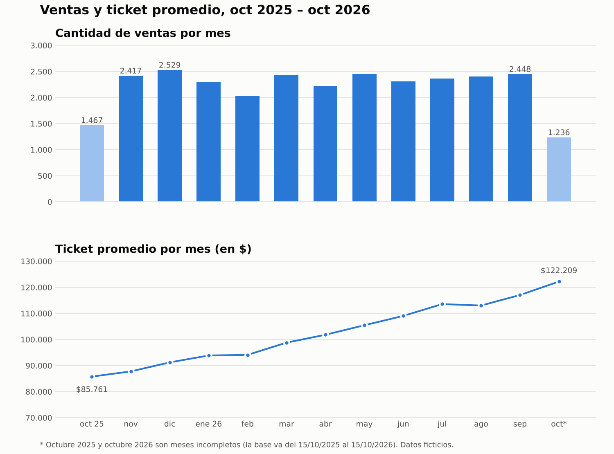

# Análisis CRM de un programa de fidelidad (SQL)

Proyecto de práctica en SQL sobre un supermercado con programa de fidelidad: ¿quiénes son los mejores clientes, cuántos se están yendo y si las campañas de mail funcionan?

> **Los datos son ficticios**, generados con un script (`datos/generar_dataset.py`). Sirven para practicar las consultas típicas de CRM, no representan a ninguna empresa real.

## Los datos

| Tabla | Qué guarda |
|---|---|
| `clientes` | alta, canal de alta, provincia, fecha de nacimiento |
| `ventas` | una fila por compra: cliente, fecha, sucursal, canal, monto |
| `detalle_ventas` | productos de cada compra |
| `productos`, `sucursales` | catálogos |
| `campanas`, `envios_campana` | campañas de mail y si cada cliente abrió o hizo clic |

Volumen: 2.000 clientes, 28.602 ventas entre octubre 2025 y octubre 2026. Motor: SQLite (consultado desde DBeaver).

## Limpieza de datos

Antes de analizar, revisé la calidad de las tablas principales:

- **`clientes` (2.000 filas):** no hay duplicados (`COUNT(*)` = `COUNT(DISTINCT cliente_id)` = 2.000). Solo `provincia` tiene faltantes: **65 clientes (3,25 %)** con valor `NULL`. El resto de las columnas está completo.
- **`ventas` (28.602 filas):** ninguna columna tiene valores vacíos.
- **Rangos en `ventas`:** las fechas van del 2025-10-15 al 2026-10-15. Los montos van de $2.910 a $416.862, sin valores negativos ni en cero.
- **Decisión:** los clientes sin provincia se mantienen en el análisis y se agrupan como "Sin dato" cuando se compara por provincia.

## Preguntas de negocio y consultas

| # | Pregunta | Técnica | Archivo |
|---|---|---|---|
| 1 | ¿Cuántos clientes, ventas y facturación total? | COUNT, SUM | `consultas/01_resumen_general.sql` |
| 2 | ¿Cómo evolucionan ventas y ticket promedio por mes? | GROUP BY, strftime | `consultas/02_ventas_y_ticket_por_mes.sql` |
| 3 | ¿Tienda u online? | GROUP BY | `consultas/03_facturacion_por_canal.sql` |
| 4 | Top clientes de los últimos 90 días | JOIN, ORDER BY, LIMIT | `consultas/04_top_clientes_90_dias.sql` |
| 5 | Una sola compra / nunca compraron | HAVING, LEFT JOIN | `consultas/05_clientes_una_sola_compra.sql` |
| 6 | Activos, inactivos y nunca compraron | CASE, CTE | `consultas/06_clientes_inactivos.sql` |
| 7 | Segmentación RFM | CTE, NTILE | `consultas/07_segmentacion_rfm.sql` |
| 8 | Retención por cohorte | CTE, fechas | `consultas/08_retencion_por_cohorte.sql` |
| 9 | Efectividad de campañas | JOIN, CASE | `consultas/09_efectividad_campanas.sql` |

## Hallazgos

Resultados ya verificados:

- La base tiene **2.000 clientes** y **28.602 ventas**, con una facturación total de **$2.929 millones** y un ticket promedio de **$102.412**.
- La **tienda genera el 72,7 %** de la facturación y el **online el 27,3 %**.
- En el top 10 de clientes de los últimos 90 días predominan Buenos Aires y CABA, en línea con su peso en la base (82 % de los clientes), así que no hay evidencia de que gasten más que otras provincias.
- **18 clientes (0,9 %) nunca compraron** y **82 (4,1 %) compraron una sola vez**: son el foco natural para campañas de activación.
- Las **ventas por mes son estables** (entre 2.000 y 2.500), pero el **ticket promedio subió 42 %** en un año: de $85.761 a $122.209. La facturación crece por precio por compra y no por más ventas. Puede ser inflación, y para confirmarlo habría que mirar unidades por compra.

*Octubre 2025 y octubre 2026 son meses incompletos.*

Pendientes (completar con mis propias consultas):

- [ ] Clientes activos vs inactivos (%).
- [ ] Segmentos RFM y qué haría con cada uno.
- [ ] Retención del mes 0 al mes 1.
- [ ] Efectividad de campañas y por qué hace falta un grupo de control.

## Próximos pasos

- [ ] Automatizar la ejecución de las consultas y la generación de gráficos con Python.
- [ ] Chequeo automático de calidad de datos.
- [ ] Reporte periódico de KPIs y lista de clientes a reactivar.

## Cómo reproducirlo

1. Abrir `datos/crm_supermercado.db` en DBeaver (conexión SQLite) o importar los CSV de `datos/csv_tablas.zip`.
2. Ejecutar cada archivo de `consultas/`.
3. "Hoy" en el dataset es 2026-10-15; usar esa fecha fija en vez de `date('now')`.
